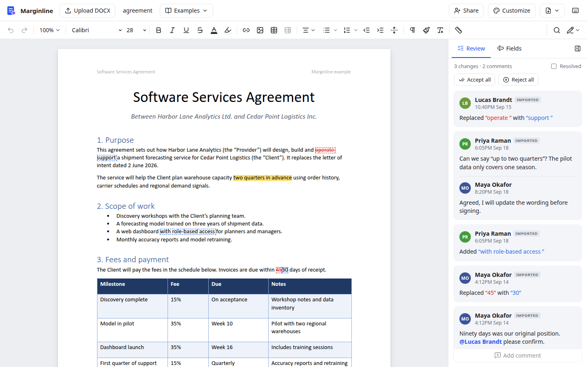
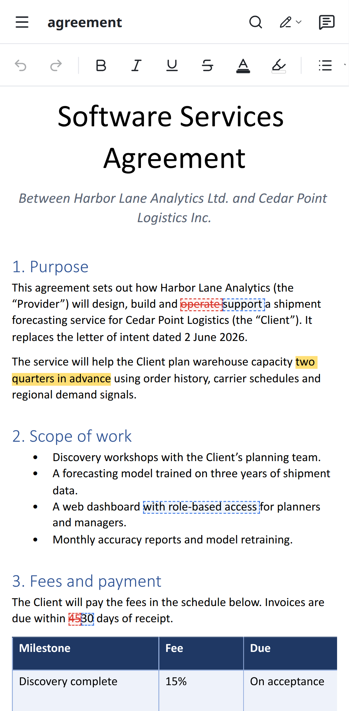
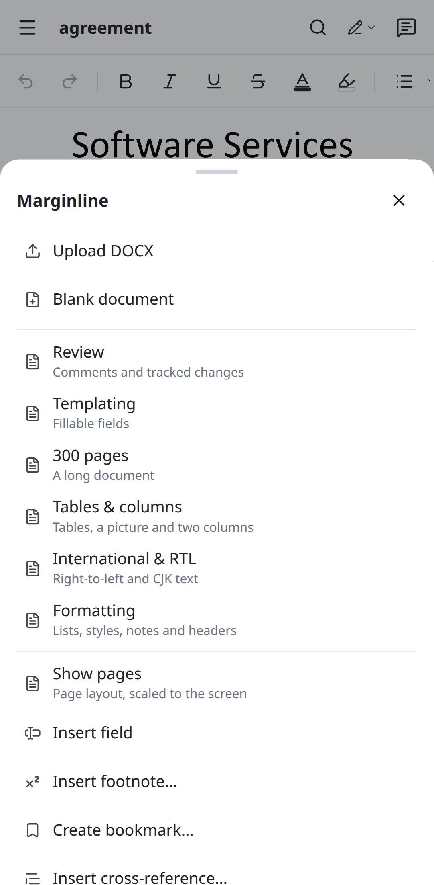

# Marginline

Marginline is a Word (DOCX) editor for desktop and mobile that runs in the browser: a one-row
toolbar with menus and overflow, a review panel with comments and suggestions, Editing, Suggesting
and Viewing modes, fillable fields, themes and a page API, on its own engine. On phones it reflows
the text and has a touch layout, and it also works over a plain HTTP address on the local network.
PDF export runs in the browser, and real-time sharing runs on a small relay built into the dev and
preview servers.

It comes as a React component and a Vue component, each written natively for its framework on one
shared engine, in a pnpm monorepo: `@marginline/core` (the engine, the page API and the interface
state), `@marginline/react`, `@marginline/vue`, `@marginline/relay` (the sharing relay), and the
full-page app built once with each component.

Its features are listed area by area in [docs/feature.md](docs/feature.md).

| Desktop | Phone | Phone menu |
| --- | --- | --- |
|  |  |  |

## Run

```bash
git clone https://github.com/mas-ony/office-marginline.git
cd office-marginline
pnpm install
pnpm dev             # the React app: http://localhost:5177, also on the LAN address Vite prints (open it on a phone)
pnpm dev:vue         # the Vue app: http://localhost:5181
                     # open an example: /?example=agreement (template, long, tables, international, formatting)
                     # open a file directly: /?src=/examples/template.docx (skip the recovery offer: /?new=1)
pnpm build           # the packages into packages/*/dist, the apps into apps/web-react/dist and apps/web-vue/dist
                     # (installable PWAs when served over HTTPS)
pnpm build:npm       # the React app without source maps in npm/dist, for the npm package
pnpm preview         # serve the React app's build on port 4177, with the sharing relay
pnpm preview:vue     # serve the Vue app's build on port 4181, with the sharing relay
pnpm test            # unit tests of all packages (pandoc and pdftotext are used for cross-checks when installed)
pnpm test:e2e        # Playwright against both apps, desktop and Pixel 7 profiles (Chrome at /usr/bin/google-chrome or $CHROME_PATH)
pnpm typecheck
pnpm fixtures        # regenerate the test documents in packages/core/tests/fixtures and the examples in apps/web-shared/public/examples
```

`E2E_BASE_URL=http://<LAN address>:5177 E2E_VUE_URL=http://<LAN address>:5181 pnpm test:e2e` runs
the browser tests against plain HTTP addresses, which are insecure contexts like a phone on the
local network (no clipboard API, service workers, file pickers or share sheet). The editor
feature-detects all of these.

To edit together, choose **Share > Start collaboration**: the document is uploaded to the relay
that the dev and preview servers serve under `/collab`, and the dialog shows a link
(`/?room=<id>`) and a QR code to open it on another device on the same network. Rooms live in
the server's memory until it stops or nobody has used them for 12 hours; a static copy of a
build served elsewhere has no relay and cannot share.

## What works

- **Files**: Upload DOCX (picker, drag and drop, `?src=`, the OS "Open with" for the installed
  app), six example documents and a blank document, Export DOCX, Export PDF, print, sending the
  file through the share sheet on phones, and recovery of unsaved work from IndexedDB. The saved
  DOCX keeps what the editor does not change: styles, numbering, sections, headers and footers,
  comments with replies, tracked changes, fields, notes, images, tables and unknown XML.
- **Toolbar**: undo and redo, zoom, font family and size, bold, italic, underline,
  strikethrough, text colour and highlight, link, image, table, table actions (rows, columns,
  merge, split, remove borders, fix tables), alignment, bullet and numbered lists (3 bullet
  styles, 8 number formats), indents, line height, linked styles, copy and clear formatting,
  ruler, search and document mode. Tools that do not fit the window move into a "⋮" popup.
- **Review**: comments from the selection with replies, @mentions, edit, delete, resolve and
  reopen; Suggesting records insertions, deletions and formatting changes as cards to accept or
  reject one by one or all at once; Viewing is read-only and shows the original, the markup or
  the final text.
- **Fields**: the Fields tab lists the document's fields (Word content controls) with their
  values; editing a value fills every place the field appears; drag "New field" onto the page
  to add one.
- **Find and replace** with match case and regular expressions; a **right-click menu** with
  comments, paste options, bookmarks, cross-references, links, tables, footnotes and table
  actions; a **ruler** with draggable margins and indents.
- **Pages**: real pagination with sections, headers and footers (edited in place; their Options menu
  inserts page numbers and sets a different first page, odd and even pages, the link to the previous
  section and the distances from the page edge), columns, footnotes and endnotes (inserted and
  edited from the menu), tables split across pages, right-to-left text and CJK.
- **PDF export** in the browser: embedded font subsets with selectable text and links; words in
  right-to-left, complex and CJK scripts are drawn as images. A 300-page document takes about
  4 seconds.
- **Sharing**: real-time editing with others through a link or QR code, with everyone's cursors
  and shared comments.
- **Customize**: Modern, Docs, Word and Blueprint themes, light or dark appearance, an example
  toolbar button and your name for comments and suggestions.
- **Phones**: text reflowed to the screen (pages on demand, scaled to fit), a scrolling
  toolbar that starts with formatting, a comment button next to the selection, the review and
  fields panels, menus and dialogs as bottom sheets, and a menu with examples, insert, export,
  share and customize. Native selection, keyboard, autocorrect and IME.
- **React and Vue**: the same interface, markup and behaviour in both components; the two apps
  differ only in the framework.

## Programming interface

### Components

`@marginline/react` and `@marginline/vue` each export a `MarginlineEditor` component and a
`mount()` function, with the same options. Import the package's `style.css` once (the fonts and
the editor's styles). The editor fills its container, so give the container a height.

```tsx
import { MarginlineEditor } from '@marginline/react';
import '@marginline/react/style.css';

<div style={{ height: '80vh' }}>
  <MarginlineEditor
    document="/contracts/lease.docx"
    documentMode="suggesting"
    user={{ name: 'Jordan Lee', email: 'jordan@example.com' }}
    onReady={(ml) => ml.on('commentsUpdate', () => console.log('comments changed'))}
  />
</div>
```

```vue
<script setup lang="ts">
import { type Marginline, MarginlineEditor, type ThemeName } from '@marginline/vue';
import '@marginline/vue/style.css';
import { ref } from 'vue';

const theme = ref<ThemeName>('docs');
const onReady = (ml: Marginline) => ml.on('commentsUpdate', () => console.log('comments changed'));
</script>

<template>
  <MarginlineEditor style="height: 80vh" document="/contracts/lease.docx" document-mode="suggesting"
    :user="{ name: 'Jordan Lee' }" v-model:theme="theme" @ready="onReady" />
</template>
```

```js
// Without writing React or Vue code (either package)
import { mount } from '@marginline/vue';
import '@marginline/vue/style.css';

const editor = mount(document.querySelector('#editor'), { document: file, theme: 'word' });
const ml = await editor.ready;
editor.update({ documentMode: 'viewing' });
editor.destroy();
```

Options, the same props in both components (`MarginlineOptions` in
`packages/core/src/ui/types.ts`):

| Option | |
| --- | --- |
| `document` | A URL, Blob, ArrayBuffer or bytes, or `{ url or data, name }`; opened again when it changes |
| `documentMode`, `viewing` | `'editing'`, `'suggesting'` or `'viewing'`; what Viewing shows (`trackedChanges`, `comments`) |
| `user` | The name (and email) on comments and tracked changes |
| `title` | The document name, in place of the file name |
| `theme`, `colorScheme` | `'modern'`, `'docs'`, `'word'` or `'blueprint'`; `'system'`, `'light'` or `'dark'` |
| `examples` | Documents for the Examples menu (no menu without them) |
| `storageKey` | Keep the theme, appearance, ruler and the user's name in localStorage |
| `autosave`, `offerRecovery` | Keep unsaved work in IndexedDB and offer to recover it |
| `relay`, `shareLink`, `room` | Sharing: the relay's URL (default `/collab`), the link to a room, a room to join at start |
| `files` | Replace some of the file actions (New, Upload, the examples, Export DOCX and PDF, Print, Send) |
| `globalShortcuts` | Handle Ctrl+F and Ctrl+Shift+E anywhere on the page |

Events: `onReady(ml)`, once the first document (or room) has opened, with the editor's page API
instance; `onUserChange`, `onThemeChange` and `onColorSchemeChange` when the reader changes them
in the interface. In Vue they are `@ready`, `@update:user`, `@update:theme` and
`@update:colorScheme`, so `v-model:user`, `v-model:theme` and `v-model:colorScheme` work.

The interface keeps its classes on its own element and on a layer it adds to the page's body for
menus, dialogs and messages (`ml-` for the interface, `ml-ui-` for menus and dialogs, `ml-dx-`
for the document). It changes nothing on `<html>` or `<body>`, and several editors can share a
page.

Sharing needs the relay on the server that serves the page:

```js
// vite.config.ts: serves /collab from `vite` and `vite preview`
import { collabRelay } from '@marginline/relay';
export default defineConfig({ plugins: [vue(), collabRelay()] });

// Any Node server (node:http, Connect, Express)
import { createRelayMiddleware } from '@marginline/relay';
app.use(createRelayMiddleware({ base: '/collab' }));
```

### Page API

Each editor comes with a page API instance (`packages/core/src/api/marginline.ts`, passed to
`onReady`): options, methods and events for the document, its modes, export and the interface,
and a Document API (query → target → mutation → receipt). `installPageApi(ml)` from
`@marginline/core` also puts it on the page, as the apps do once the first document (or shared
room) has opened: `window.marginline` for that editor, `window.Marginline` to start over with a
configuration, and `window.docxEditor` for the native editor (`DocxEditor`,
`packages/core/src/editor/DocxEditor.ts`).

```js
const ml = window.marginline;
const { items } = await ml.doc.query.match({ select: { type: 'text', pattern: 'twelve months' }, require: 'first' });
await ml.doc.replace({ target: items[0].target, text: 'eighteen months' }, { changeMode: 'tracked' });
const changes = await ml.doc.trackChanges.list();
ml.setDocumentMode('viewing');
ml.setViewingOptions({ trackedChanges: 'final' });
ml.on('zoomChange', ({ zoom }) => console.log(zoom));
const blob = await ml.export({ exportType: ['docx'], triggerDownload: false, commentsType: 'clean' });
await new Marginline({ document: '/examples/template.docx', documentMode: 'suggesting', user: { name: 'Jordan Lee' } }).ready;
```

`new Marginline()` drives an editor that is already on the page: by default the one given to
`installPageApi`, or with `selector` (an element or a CSS selector inside or around it) one of
several.

## Tests

- 115 unit tests (Vitest). In `@marginline/core`: XML, import, export and round trips of five test
  documents and the six examples (each also compared through pandoc), footnotes and endnotes,
  fields, review features (comments, suggesting and viewing, regular-expression search, list styles,
  table actions, bookmarks and cross-references, footnote editing, copy formatting), paragraph
  spacing around borders and shading, floating picture placement, the PDF writer and fonts (text
  checked with pdftotext), the header and footer distances typed in the Options menu, and the page
  API with several editors on a page. In `@marginline/relay`: rooms, two simulated clients editing
  at once, late joiners and another base path. In `@marginline/react` and `@marginline/vue`, the
  same scenarios for `mount()`: opening a document with a title and a theme and cleaning up,
  Customize in the layer reporting the new name, and two editors on one page.
- 52 end-to-end tests (Playwright), the same 26 against the React app and the Vue app: 19 desktop
  (toolbar formatting, the overflow menu on narrow windows, comments with replies and resolve,
  suggestions accepted and rejected, Viewing with original, markup and final, filling fields,
  regular-expression replace all, the right-click menu with tables, bookmarks, cross-references and
  footnotes, DOCX and PDF export, the page API, themes and dark appearance, the 300-page example,
  page numbers in the text, a click on a square-wrapped picture over the paragraph that wraps around
  it, header editing, the header Options menu (page X of Y, distances, a different first page,
  linking a section to the previous one), dragging a margin on the ruler, two people editing in real
  time) and 7 mobile (Pixel 7: tap and type in reflowed text, a tap through the message at the
  bottom of the screen, bottom-sheet menus, comments and the review sheet, the phone menu with page
  view and fields, the find bar, export). The suite also passes over plain HTTP LAN addresses.

## Layout

| Path | Contents |
| --- | --- |
| `packages/core` | `@marginline/core`, everything the two interfaces share |
| `packages/core/src/core` | DOCX package (`ooxml/`), XML parser and serializer (`xml/`), document model and ProseMirror schema (`model/`), import (`import/`) and export (`export/`), blank documents |
| `packages/core/src/editor` | The editor (`DocxEditor.ts`): commands, keymap, node views, pagination (`layout/`), headers and footers, footnotes and endnotes, fields, bookmarks and cross-references, table actions, copy formatting, clipboard, plugins for comments, tracked changes, presence, numbering, search and table styles |
| `packages/core/src/ui` | The interface without a framework: its state and actions (`controller.ts`, `MarginlineUI`), the editor's state for the views (`store.ts`), toolbar layout, review cards, ruler geometry, menus' keyboard and placement, autosave, options and types |
| `packages/core/src/styles` | Fonts, document styles (`editor.css`), interface styles and themes (`ui.css`) |
| `packages/core/src/pdf` | PDF export: font reader and subsetter (`sfnt.ts`), PDF writer, collector of the laid-out pages |
| `packages/core/src/collab` | Sharing session: sends and receives editing steps, comments and cursors |
| `packages/core/src/api` | Page API (`Marginline`, `installPageApi`) and document sources |
| `packages/core/tests` | Unit tests and test documents (`fixtures/`, generated by `scripts/make-fixtures.mjs`, plus a pandoc sample); to rebuild the pandoc sample from `sample.md`, run `SOURCE_DATE_EPOCH=1704067200 pandoc sample.md -o pandoc-sample.docx` in `fixtures/` (the fixed date makes repeated runs give the same file) |
| `packages/react` | `@marginline/react`: `MarginlineEditor` and `mount()`; header, toolbar (`toolbar/`), review panel and cards (`review/`), Fields panel, find bar, ruler, right-click menu, header and footer Options menu, dialogs, Share dialog, phone sheets |
| `packages/vue` | `@marginline/vue`: the same in Vue single-file components (`controls/`, `header/`, `toolbar/`, `review/`, `dialogs/`) |
| `packages/relay` | `@marginline/relay`: sharing relay, as a Vite plugin or Node middleware |
| `apps/web-react` | The full-page app in React |
| `apps/web-vue` | The same app in Vue |
| `apps/web-shared` | What both apps share: `src/shell.ts` reads the address, lists the examples, sets the window title, opens dropped files and installs the page API; `src/app.css` has the page styles; `public/` has the icons, manifest, service worker and example documents (generated by `scripts/make-fixtures.mjs`); `vite/assetLicenses.ts` completes the builds' licence files |
| `tests/e2e` | Playwright tests, run against both apps |
| `scripts` | Test documents and examples (`make-fixtures.mjs`) |
| `npm` | The npm package `marginline` (the built React app): its manifest, README and licence. Packing or publishing it there (`pnpm pack`, `npm publish`) runs `pnpm build:npm` first, and the package holds only `dist` |

## Known gaps

- The packages in `packages/` are not published to npm yet (they are marked private); another
  project can use them from this workspace or from `pnpm pack` archives.
- Sharing needs the relay (in the dev and preview servers, or `@marginline/relay` on another
  server); rooms live in memory, anyone who can reach the server with the link can join, and
  headers, footers and footnotes cannot be edited while a document is shared.
- Line numbering (for example on pleading paper) is kept in the file but not shown, and very long
  documents are laid out in full, without page virtualisation.
- Block-level content controls are opened as plain content; only inline ones become fields.
- In multi-column sections a paragraph moves to the next column as a whole; a footnote taller
  than the space left on its page is not continued on the next page.
- Equations, charts, SmartArt and text boxes are kept unchanged but shown as placeholders.
- Fonts that are not installed are replaced with metric-compatible open fonts, so line breaks can
  differ slightly from Word.
- In PDF files, words in right-to-left, complex and CJK scripts are pictures, not selectable
  text.

## License

MIT ([LICENSE](LICENSE)). Each package in `packages/` and the npm package in `npm/` carry a copy,
with their own README for npm. The app builds write `THIRD-PARTY-LICENSES.md` next to the app,
listing the bundled packages, icons and fonts with their licences
(`apps/web-shared/vite/assetLicenses.ts` adds the fonts, which come in through CSS, and the notice
from the top of qrcode-generator's script, since that package has no licence file); the fonts come
from the `@fontsource` packages under the SIL Open Font License 1.1.
